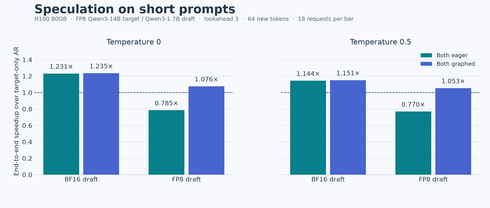
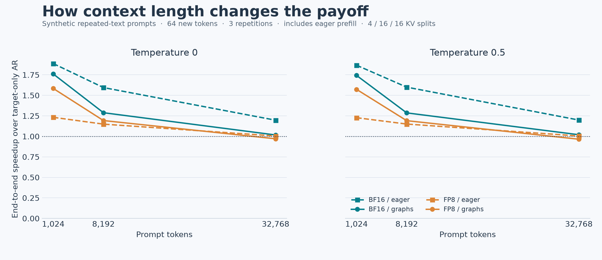
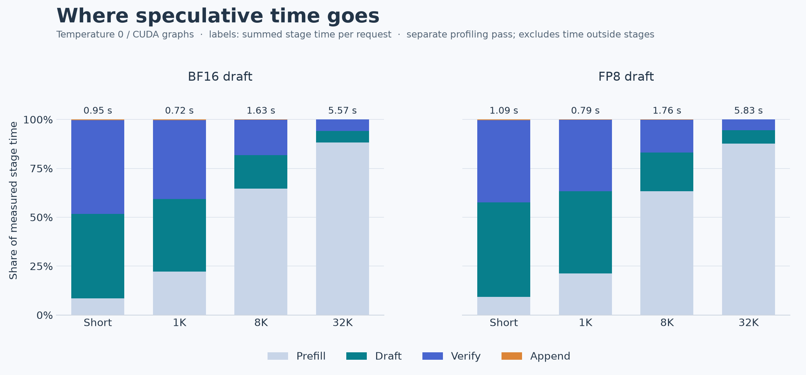
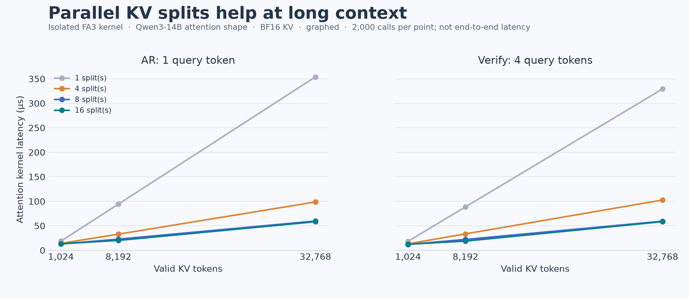

# Speculative Sampling

Batch-size-one speculative sampling for **Qwen3**, with an FP8 target and a BF16
or FP8 draft. Both autoregressive (AR) and speculative decoding use
FlashAttention-3 and persistent KV caches. **Lookahead defaults to 3; execution
is eager unless `--cuda-graphs` is passed.**

Supports full-attention Qwen3 models with default rotary embeddings, on CUDA
with FP16/BF16 activations. FP8 weights retain BF16 activations and KV storage.
The implementation and measurements here are validated on an NVIDIA H100 80GB.

## Setup and generation

```bash
uv sync --locked --extra fp8

TRANSFORMERS_DISABLE_DEEPGEMM_LINEAR=1 uv run --locked --extra fp8 generate.py \
  --method speculative \
  --target_model Qwen/Qwen3-14B-FP8 \
  --draft_model Qwen/Qwen3-1.7B \
  --prompt "Emily found a mysterious letter on her doorstep one sunny morning." \
  --max_new_tokens 64 --temperature 0.5
```

Use `--method autoregressive` for target-only decoding, or add `--cuda-graphs`
to either method. `--draft_model Qwen/Qwen3-1.7B-FP8` selects an FP8 draft.
`uv run generate.py --help` lists the CLI options.

Python 3.12 and the Linux CUDA 12.6 PyTorch build are selected by the project.
The `kernels` package downloads a pinned FlashAttention-3 build on first use;
no local CUDA compilation is needed. The environment variable above selects
Transformers' Triton FP8 linear kernels, as used in the measurements. CPU/FP32
inference is not supported.

## Decoding stages

| Stage | Work | CUDA graph mode |
|---|---|---|
| Prefill | Run FlashAttention over the actual prompt for both models; sample the first target token. | Always eager |
| Draft | Generate `lookahead` proposals incrementally from draft KV. | One graph |
| Verify | Score the pending token plus proposals in a single target forward; accept a prefix and select a correction or bonus. | One graph |
| Append | Write accepted tokens and the correction/bonus; clip the output budget and rewind KV cursors. | One graph |

The AR baseline has its own eager prefill and a single graph for one-token
forward, sampling, and append. With graphs disabled, every stage runs eagerly.
The same `graph_mode` applies to both methods in each benchmark row.

After append, target KV covers all but the last committed token; draft KV
covers all but the last two. The first draft forward consumes two tokens,
then subsequent draft forwards consume one. Verify always consumes
`lookahead + 1` tokens. These fixed query shapes also apply to the final
partial output block.

KV storage and output/proposal buffers persist for the decoder's lifetime.
Cache lengths, acceptance count, and output limit live on the GPU. Rejection
rewinds the logical cursors; subsequent writes overwrite abandoned entries.
FlashAttention reads only the valid KV prefix and applies causality inside the
kernel, without building a mask over the reserved capacity. The cache is
contiguous, not paged: unused capacity still costs memory, but does not require
attention over unused positions. Prefill uses `flash_attn_func`; decode uses
`flash_attn_with_kvcache` after StaticCache writes the new KV entries.

### Split policy and graph reuse

KV splitting divides attention over the valid sequence among parallel work
units, then combines their softmax statistics and outputs. A simple heuristic
chooses the split count **once per request**, from its initial prompt length:

| Prompt tokens | `num_splits` |
|---:|---:|
| 1–511 | 1 |
| 512–4,095 | 4 |
| 4,096 and above | 16 |

Both models and both decoding methods use this policy. The count remains fixed
while generating, even if the sequence crosses a threshold. This is an H100
approximation informed by the kernel measurements below, not an autotuner.

A decoder caches graph variants by split count. The first request in a new
bucket captures that variant; later requests in that bucket reuse it, even
with different prompt lengths and output budgets. Returning to an earlier
bucket reuses its original graphs. All variants share the decoder's persistent
KV/output buffers; each captured stage has a private graph memory pool.

Models, temperature, lookahead, and capacity are fixed per decoder. Choose
`max_seq_len` for the largest committed sequence you intend to serve; the
speculative cache reserves `lookahead` additional scratch slots. Oversized
requests fail validation. Decoders serve requests sequentially.

```python
from speculative_sampling import SpeculativeDecoder

decoder = SpeculativeDecoder(
    target_model, draft_model, prompt_a,
    target_len=prompt_a.shape[1] + 64,
    max_seq_len=8192, lookahead=3, temperature=0.5, cuda_graphs=True,
)
first = decoder.generate()
second = decoder.generate(prompt_b, target_len=prompt_b.shape[1] + 128)
```

`AutoregressiveDecoder` supports the same capacity and per-request target
length. The convenience sampling functions and generation CLI construct a new
decoder per call, so their latency includes capture. The outer speculative
loop checks completion on the host once per round; the captured stages contain
no host scalar reads.

## Measured performance

[Full results](outputs/benchmark.csv): **32 configurations**, all with
Qwen3-14B-FP8 as target, Qwen3-1.7B BF16/FP8 drafts, batch size 1, lookahead 3,
64 new tokens, temperatures 0/0.5, eager/graph modes, and three repetitions.
Both prefill and decode use FlashAttention-3; decode uses the split policy above.

Short prompts are six narrative/question prompts, 6–23 tokens each, giving
18 measured requests per configuration. The long-context workload uses one
repeated-text synthetic prompt at each of 1,024, 8,192, and 32,768 tokens,
giving three requests per configuration. **The repeated long prompts make
acceptance easier and are context/capture stress tests, not representative
long-document workloads.**

### Short prompts

| Draft | Temperature | Eager speedup | Graph speedup | Graph AR tok/s | Graph spec tok/s | Accepted/round |
|---|---:|---:|---:|---:|---:|---:|
| BF16 | 0 | 1.231× | 1.235× | 54.47 | 67.29 | 1.500 |
| BF16 | 0.5 | 1.144× | 1.151× | 54.26 | 62.43 | 1.383 |
| FP8 | 0 | 0.785× | 1.076× | 54.41 | 58.53 | 1.484 |
| FP8 | 0.5 | 0.770× | 1.053× | 54.19 | 57.07 | 1.471 |

Acceptance counts draft proposals only, excluding correction/bonus tokens.
The table uses graph-mode acceptance; eager and graph profiling are checked
separately in the CSV.



With CUDA graphs, the BF16 draft reaches **1.235× / 1.151×** speedup
at temperatures 0 / 0.5. The FP8 draft reaches 1.076× / 1.053×.
A smaller weight format does not guarantee a faster draft at batch size one.
These are warmed-request ratios against AR with the same graph mode.

### Long context

Temperature-0 end-to-end speedups over the matching AR mode:

| Prompt tokens | BF16 eager | BF16 graphs | FP8 eager | FP8 graphs |
|---:|---:|---:|---:|---:|
| 1,024 | 1.888× | 1.761× | 1.232× | 1.584× |
| 8,192 | 1.595× | 1.288× | 1.149× | 1.193× |
| 32,768 | 1.197× | 1.017× | 1.005× | 0.971× |



At 32K, the BF16-draft graph run averages **5.52 s** per request versus
**5.62 s** for AR (1.017×). The separate profile spends
4.92 s/request in the two-model prefill, 88.3% of summed stage time.
For only 64 output tokens, this prefill cost limits the end-to-end benefit of faster decoding.



### Why split KV attention

The [isolated kernel measurements](outputs/kv_split_benchmark.csv) cover
48 cases: target AR/verify and draft query shapes, 1K/8K/32K valid lengths,
and 1/4/8/16 splits. On H100, target-shaped one-token attention at 32K took
**353.9 µs with one split versus 58.4 µs with 16 splits**; four-token verify
attention took 329.3 µs versus 58.5 µs. These are attention-only timings,
excluding prefill, model projections, and sampling.



## Running benchmarks

Run these commands from the project root. Each invocation prints experiments,
warmups, repetitions, and profiling progress, flushing each CSV row as it finishes.
It **replaces** the selected output file; use separate paths to retain runs.

```bash
# Six short prompts, both draft precisions and temperatures.
TRANSFORMERS_DISABLE_DEEPGEMM_LINEAR=1 uv run --locked --extra fp8 \
  python -m benchmarks.benchmark --output /tmp/short_eager.csv

# Same workload with matched AR/speculative graphs and replay validation.
TRANSFORMERS_DISABLE_DEEPGEMM_LINEAR=1 uv run --locked --extra fp8 \
  python -m benchmarks.benchmark --cuda-graphs --check-graphs \
  --output /tmp/short_graphs.csv

# Long-context matrix; omit the two graph flags for its eager counterpart.
TRANSFORMERS_DISABLE_DEEPGEMM_LINEAR=1 uv run --locked --extra fp8 \
  python -m benchmarks.benchmark --prompt-lengths 1024 8192 32768 \
  --cuda-graphs --check-graphs --output /tmp/long_graphs.csv

# Isolated attention split measurements.
uv run --locked python -m benchmarks.benchmark_kv_splits
```

`--lookahead`, `--max-new-tokens`, and `--repeats` change the defaults.
Target and draft model overrides are listed by `--help`.
The checked-in CSV combines the four short/long × eager/graph runs.

### Timing and validation

- **End-to-end:** synchronized wall time from request validation through
  prefill and decoding, with warmed reusable decoders. Model loading,
  tokenization, allocation, warmup, and capture are excluded. Measurement order
  alternates between AR and speculative decoding. Both generate the requested
  token count, even after EOS. Speedup is total AR time / total speculative time.
- **Stage timing:** a separate pass with the first repetition's seeds records
  CUDA events for prefill/draft/verify/append. Prefill is milliseconds per request
  for both models together; the other stages are milliseconds per round.
  Event intervals include GPU idle time between launches. They do not determine
  the end-to-end speedup, and their sum excludes time outside the stages.
- **Acceptance:** `profile_avg_accepted_draft_tokens` includes all accepted
  proposals in the final block, even when the output budget truncates it.
  `profile_avg_committed_tokens` includes correction/bonus tokens, excludes
  the prefill token, and counts only committed output.
- **Graphs:** `--check-graphs` captures at representative bucket lengths,
  replays at the requested lengths, and returns to a short prompt. It checks
  exact eager/graph tokens and CUDA RNG, stable buffer/graph identities, and
  Python forward hooks showing only eager prefill on reuse. Checks are excluded
  from timing. `ar_graph_count`/`spec_graph_count` include every captured bucket,
  including validation-only variants; setup seconds are recorded separately.
- **Memory:** `peak_allocated_gib` includes both models and both AR/speculative
  decoders in the benchmark process, not the footprint of one request.

All **16 real-model graph configurations** passed eager/graph token and RNG
equivalence and buffer/graph reuse checks. All 22 automated tests passed on H100.
Greedy AR/speculative outputs matched in **72/108 measured requests**:
9/18 in each short-prompt configuration, and 3/3 in each long-context
configuration. Peak benchmark allocation was 36.55 GiB.

A traced short-prompt divergence reached tied AR logits of 27.625/27.625,
while the verifier's accumulated KV history yielded 27.375/27.5 for those
same two tokens. One-token and block forwards from the *identical verifier KV*
produced bitwise-identical logits at that position. Exact AR/speculative greedy
parity can therefore fail even when eager/graph replay agrees; the CSV retains
those match counts rather than assuming equivalence.

Three repetitions provide a small local comparison, not confidence intervals.
Changing FP8 kernel shapes or split counts can change floating-point rounding;
bitwise greedy parity with AR is checked in each run rather than assumed.

## Tests, plots, and layout

```bash
uv run --locked --extra fp8 python -m unittest discover -s tests -t . -v
uv run --locked --extra plots python -m plots.benchmark_plots
```

The suite checks sampling, rejection rollback, poisoned unused KV, output
budgets, FlashAttention logits against an independent full-prefix SDPA
reference, and graph reuse at split boundaries and through 32K tokens.
GPU tests skip when CUDA is unavailable. Plot generation validates the complete
32-row matrix and speedup arithmetic before writing four PNG figures.

```text
./                       Generation CLI, decoders, cache and sampling helpers
benchmarks/              End-to-end and isolated KV-split benchmark scripts
tests/                   Sampling, cache, graph, and benchmark tests
plots/                   Reproducible Matplotlib figure code
outputs/benchmark.csv    End-to-end measurements and separate stage profiles
outputs/kv_split_benchmark.csv
outputs/figures/          README figures generated from those CSVs
```

The sampling algorithm follows
[Accelerating Large Language Model Decoding with Speculative Sampling](https://arxiv.org/abs/2302.01318).
